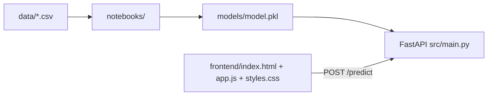

# TripSight — NYC Taxi Trip Duration Prediction

An end-to-end machine-learning project that predicts the duration of a New York City taxi trip from its route, pickup time, passenger count, vendor, and store-and-forward status. The trained regression model is exposed through a FastAPI backend and a dependency-free browser frontend.

**Author:** Muhammad Ammar · **Repository:** `mu-3mar/nyc-taxi-duration-prediction`

| | |
|---|---|
| **Task** | Regression — predict `trip_duration` in seconds |
| **Inputs** | Pickup/drop-off coordinates, pickup datetime, passenger count, vendor, and `store_and_fwd_flag` |
| **Output** | Estimated duration in minutes |
| **Model** | Saved Ridge regression pipeline (`models/model.pkl`) |
| **Stack** | Python, pandas, NumPy, scikit-learn, joblib, FastAPI/Uvicorn, vanilla HTML/CSS/JavaScript |
| **Frontend** | Static and independent from the API; it calls FastAPI only when a backend is available |
| **Status** | Local model/API and browser UI are wired end to end |

> **Important:** this is a demonstration model. The estimate does not account for live traffic, road closures, weather, or real-time taxi availability.

## Table of Contents

1. [Project overview](#1-project-overview)
2. [Dataset](#2-dataset)
3. [ML workflow](#3-ml-workflow)
4. [System architecture](#4-system-architecture)
5. [API](#5-api)
6. [Frontend](#6-frontend)
7. [Installation and usage](#7-installation-and-usage)
8. [Project structure](#8-project-structure)
9. [Limitations and next steps](#9-limitations-and-next-steps)

## 1. Project overview

The project follows this workflow:

```text
CSV trip data
   └─► EDA and cleaning
        └─► feature preparation
             └─► Ridge regression pipeline
                  └─► models/model.pkl
                       └─► FastAPI /predict ──► standalone TripSight frontend
```

The preprocessing step derives:

- pickup hour, day of week, day, and month;
- haversine distance between pickup and drop-off;
- `log1p(distance)`;
- `log1p(trip_duration)` during training.

At inference, the API reverses the target transform with `expm1` and returns minutes.

## 2. Dataset

The original dataset is private and is not redistributed. The repository includes a tracked [dataset note](data/data.md) with a public Kaggle reference dataset that has a similar schema.

When available locally, place the project CSV files in `data/`:

```text
data/
├── cleaned_data.csv
├── train.csv
├── val.csv
└── test.csv
```

CSV files are ignored by Git because the source data is not intended to be published. The expected columns are:

| Column | Meaning |
|---|---|
| `id` | Trip identifier |
| `vendor_id` | Taxi technology/vendor identifier |
| `pickup_datetime` | Pickup timestamp |
| `pickup_longitude`, `pickup_latitude` | Pickup coordinates |
| `dropoff_longitude`, `dropoff_latitude` | Drop-off coordinates |
| `passenger_count` | Number of passengers |
| `store_and_fwd_flag` | Whether the record was stored before transmission |
| `trip_duration` | Target duration in seconds |

## 3. ML workflow

- [notebooks/01_eda.ipynb](notebooks/01_eda.ipynb) explores the data and documents distributions and data quality.
- [notebooks/02_model.ipynb](notebooks/02_model.ipynb) prepares features, trains the Ridge pipeline, and writes `models/model.pkl`.
- [src/preprocessing.py](src/preprocessing.py) is the shared feature transformation used by training/evaluation and the API.
- [src/evaluate.py](src/evaluate.py) calculates R² and MSE for validation and test data.
- [scripts/run_evaluate.py](scripts/run_evaluate.py) runs the evaluation against `data/val.csv` and `data/test.csv`.

The serialized model is kept in `models/model.pkl`, the single model artifact used by the API.

## 4. System architecture



The frontend is not bundled into FastAPI and has no build step or Node.js dependency. It can be opened directly as a static page or served with any static-file server. The API status pill shows `Frontend only` when FastAPI is unavailable; the page remains usable for entering, resetting, and randomising trip data. When no URL is configured, it first checks the current origin and then automatically checks `http://127.0.0.1:8000`.

To connect a separately served frontend to the API, append the backend URL as a query parameter:

```text
http://127.0.0.1:5500/?api=http://127.0.0.1:8000
```

Without `?api=...`, the page uses the same origin. This is convenient when a reverse proxy serves both pieces together.

## 5. API

Start the backend from the repository root:

```bash
uvicorn src.main:app --reload --host 127.0.0.1 --port 8000
```

- `GET /` — liveness response and link to the interactive docs.
- `POST /predict` — returns the estimated duration in minutes.
- `GET /docs` — Swagger UI generated by FastAPI.

Example request:

```bash
curl -X POST http://127.0.0.1:8000/predict \
  -H "Content-Type: application/json" \
  -d '{
    "id": "id123",
    "vendor_id": 2,
    "pickup_datetime": "2016-06-08T07:36",
    "pickup_longitude": -73.9856,
    "pickup_latitude": 40.7359,
    "dropoff_longitude": -73.9803,
    "dropoff_latitude": 40.7605,
    "passenger_count": 1,
    "store_and_fwd_flag": "N"
  }'
```

Example response:

```json
{"predicted_duration": 12.4}
```

`predicted_duration` is in minutes. The API accepts ISO-like timestamps, including the `datetime-local` value produced by the frontend.

## 6. Frontend

The [frontend/](frontend) directory is a standalone static application:

- [index.html](frontend/index.html) contains taxi-specific inputs, route sections, result cards, and the project's animated logo.
- [app.js](frontend/app.js) builds the API request, checks backend availability, handles errors, and renders minutes plus approximate seconds.
- [styles.css](frontend/styles.css) contains the responsive TripSight visual design.
- [logo-animated.html](frontend/logo-animated.html) is the existing animated logo widget, embedded without changing its internals.

Serve it independently:

```bash
python -m http.server 5500 --directory frontend
```

Open <http://127.0.0.1:5500>. To use the local API while keeping the frontend separate, open:

```text
http://127.0.0.1:5500/?api=http://127.0.0.1:8000
```

The **Randomize trip** button generates plausible NYC coordinates, a recent pickup time, and valid categorical values. It does not generate a prediction locally: predictions require the trained model through the API.

## 7. Installation and usage

```bash
git clone https://github.com/mu-3mar/nyc-taxi-duration-prediction.git
cd nyc-taxi-duration-prediction

python -m venv .venv
source .venv/bin/activate              # Windows: .venv\Scripts\activate
pip install -r requirements.txt
```

`requirements.txt` is the complete environment for training, evaluation, notebooks,
and the API. For the API runtime only, install `requirements-docker.txt` instead.

Run the API and frontend in two terminals:

```bash
# Terminal 1
uvicorn src.main:app --reload --host 127.0.0.1 --port 8000

# Terminal 2
python -m http.server 5500 --directory frontend
```

Then open `http://127.0.0.1:5500/?api=http://127.0.0.1:8000`.

To reproduce the model artifact, run the notebooks from the repository root. To evaluate the saved artifact:

```bash
python scripts/run_evaluate.py
```

This command requires `data/val.csv` and `data/test.csv`.

### Docker

Build and run the API image:

```bash
docker build -t nyc-taxi-duration-api .
docker run --rm -p 8000:8000 nyc-taxi-duration-api
```

The Docker image installs only `requirements-docker.txt` and copies the API source
and trained model. The frontend remains a separate static application.
The runtime pins scikit-learn to `1.5.1`, which is the version used to serialize
the current model artifact.

## 8. Project structure

```text
nyc-taxi-duration-prediction/
├── README.md
├── requirements.txt
├── requirements-docker.txt
├── Dockerfile
├── models/
│   └── model.pkl                     # API artifact
├── src/
│   ├── __init__.py
│   ├── main.py                       # FastAPI app and /predict contract
│   ├── preprocessing.py              # time, distance, and log transforms
│   └── evaluate.py                   # validation/test metrics
├── scripts/
│   └── run_evaluate.py
├── notebooks/
│   ├── 01_eda.ipynb
│   ├── 02_model.ipynb
│   └── archive/                       # earlier exploratory notebooks
├── frontend/
│   ├── index.html                    # independent static UI
│   ├── app.js                        # optional API integration
│   ├── styles.css
│   └── logo-animated.html            # project logo
└── data/
    ├── data.md                       # source and privacy note
    └── *.csv                         # local, ignored data files
```

## 9. Limitations and next steps

- The original data cannot be reproduced from the repository because it is private.
- Predictions do not use live traffic or map routing; coordinates are converted only into straight-line haversine distance.
- There is no local fallback model in the browser. The UI intentionally stays independent, while a prediction requires the API.
- API input validation is currently limited to the Pydantic field types and the HTML form constraints.
- The project would benefit from automated API tests, pinned dependency versions, a Docker deployment, and a single reproducible training script.

## Credits

**Muhammad Ammar** — data preparation, EDA, modeling, API, and frontend integration.
